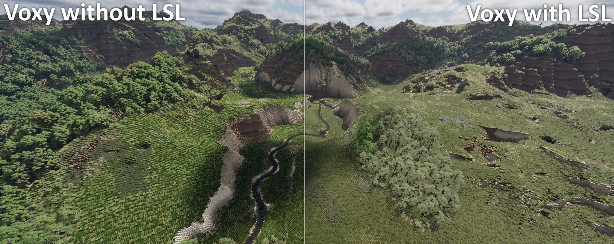

# LSL - Layer Supported LOD

Layers drawn right in LOD renderers, for worlds built from partial-height layers (AronaLayers-gen,
Conquest Reforged):

- **[Distant Horizons](https://modrinth.com/mod/distanthorizons)**: exact layer heights in eighths of
  a block, with whole-block rounding as the fallback. This moved here from AronaLayers-gen (it shipped
  in gen 1.6.0). Minecraft 1.20.1, 1.21.1, 1.21.11, 26.1.2, 26.2, 26.3 (Fabric), and 1.21.1
  (NeoForge).
- **[Voxy](https://modrinth.com/mod/voxy)**: layers kept at every LOD level, plants lowered onto them,
  and Conquest Reforged's look (Polytone colours, Continuity textures, tall and wide plant models)
  carried into the LODs. **Proof of concept**: Fabric 26.1.2 with Voxy `0.2.18-beta` (commit
  `4643445e`), and NeoForge 1.21.1 with Voxy `0.2.16-beta` (the 1.21.11 build, commit `59b62bee`)
  through [Roxy](https://github.com/RasaNovum/Roxy) `0.4.1` (see below).

*A Conquest Reforged valley in Voxy's LODs. Without LSL (left), the layered ground rounds up into
whole-block steps. With LSL (right), the meadows keep their layer heights, and the grass and trees
keep Conquest's colours.*

Each part stays idle when its LOD mod is absent. Runs on both sides: DH also builds LODs on servers.

## Layers: who decides

`LayerInfo` answers every "is this a layer, how tall, what does it stand for" question:

- **With AronaLayers-gen installed:** gen's `io.arona74.aronalayersgen.api.LayersApi`, reached by
  reflection so neither mod needs the other's jar to build. Gen knows its configured mappings, which
  full block a layer stands for even when the names differ, VanillaLayer+ 3D layers, and wall pieces.
- **Without gen:** shape detection (`LayerShapes`). A floor layer has a `layers`/`layer` property,
  isn't a plant, and its outline fills the footprint from y=0. Its full block is found by name
  (`x_layer` / `x_slab` -> `x`), otherwise it's the same layer at 8 layers.

A gen older than this split (up to 2.0.0a3 *with* its own DH code) is detected by class. LSL's DH
support then stays off and gen's keeps working, so the two never hook DH twice.

## Distant Horizons

DH stores LOD columns in whole blocks and draws every layer as a full opaque block, so distant terrain
stands a block too high wherever a layer lies.

- **Exact heights** (`dh_exact_layers`, DH 3.3.2-3.3.4): mixins rewrite DH's render data in eighths
  of a block, per 64x64 section. They also patch DH's terrain shader, and Iris's DH shader when a
  shader pack is on. The eighths ride in colour bits by default (`dh_exact_layers_color_bits`), so
  dimensions up to DH's 4096-block limit work; without colour bits the limit is 512 blocks.
  Shader packs that snap DH vertices to the block grid (Bliss does, on part of the position) are
  rewritten to keep the eighths. With `dh_layer_sides`, the top of the block under each layer
  takes the layer's colour, so a slope's small steps show a block's worth of layer on their sides
  (as full-block layers did) instead of a sliver over dirt, which made distant slopes brown.
- **Rounding** (`dh_layer_rounding`, any recent DH, public API only): a layer of
  `dh_layer_rounding_threshold` eighths or more shows as its full block, a thinner one as nothing
  (water when waterlogged).

Switching `dh_exact_layers` or `dh_layer_rounding` changes what DH saves, so existing LODs keep their
old look until DH's LOD data is cleared (or in a new world). `dh_exact_layers_color_bits` doesn't.
With gen, DH's own distant generation only gets layers when gen's `injection_mode` is `POST_FEATURES`.

Client command `/lsl dh` (was `/algdebug dh`): hook timings. `/lsl dh reset` starts a new measurement,
and `/lsl dh skip none|refine|trim` turns the refine pass or the column-view trim off for new LODs.

The exact-height technique is adapted from [Geostep](https://modrinth.com/mod/geostep) (MIT), see
`THIRD_PARTY_NOTICES.md`. The colour-bit encoding is inspired by the Tellus build of DH.

## Voxy

Voxy bakes each block state's model once, from six directions, into 16x16 face pictures with
per-pixel depth, at block 0,0,0 of a stand-in world. It then meshes the world from those pictures.
Voxy has no API, so every change below is a mixin on its internals, gated to `0.2.18-beta`
(`VoxyGate`, `LslMixinPlugin`).

**NeoForge 1.21.1 (Roxy).** Roxy rewrites the Fabric Voxy jar for NeoForge 1.21.1 at game start
(Mojang names, its own bridge calls), so `neoforge_1_21_1` hooks Voxy *as Roxy patched it*: it
compiles against that patched jar and is gated to Voxy `0.2.16-beta` with Roxy `0.4.1`. It shares
the hooks in `voxy/` with 26.1.2; its own `voxy/VoxyMc` reads 1.21.1's packed `BakedQuad`s, and its
bakery mixin wraps the `BakedModel.getQuads(state, side, random)` call. Voxy's mesher, mipper and quad layout are identical
between 0.2.16 and 0.2.18. Ported: layer mip, shape culling, flat layer shading, ext blades, split
large faces, plant offsets and grounding, plant face inset, full mipmaps, tall plants, connected
textures with the repeat average and its cache, tint matching (Polytone colormaps are sampled under
Roxy's provider proxy, so Roxy's choice of tint index still applies), plant saturation, and
`/lsl voxy tint` and `/lsl voxy ctm`.
Connected textures on 1.21.1 go through Fabric's older renderer API (from Forgified Fabric API):
`CtmBake` gives Continuity a render context of its own. Sodium (always present with Roxy) is the
renderer there and replaces every plain model's `emitBlockQuads` with one that casts the context to
its own `AbstractBlockRenderContext`, so the context is a subclass of that (`SodiumCtmContext`,
written against Sodium 0.8.13): Sodium applies Continuity's quad transforms, and the finished quads
are kept instead of being drawn. Without Sodium, `CtmBake.Capture` does the same with the public API
only. The startup log line `[LSL/Voxy] LSL <version> on Voxy <version> - ...`
lists every option's state; `Voxy hooks are off` means a version mismatch.

### Terrain

- **Layer mip** (`MipperMixin` -> `LayerMip`). Voxy's `Mipper.mip` keeps the 2x2x2 child with the
  highest light dampening, then the top-most, so from LOD1 up layers vanish and terrain rounds up to
  whole blocks. LSL takes over when a layer is the top surface of the tallest of the cell's four
  columns: the cell becomes the same layer block at the column's height relative to the cell (stone +
  4/8 layer = 12/16 of the cell, a 6/8 layer). Each level mips the previous one, so heights carry
  through LOD4, and water above a bottom layer keeps the waterlogged variant. This changes **stored**
  LOD data (fresh world, or let Voxy re-ingest).
- **Shape-aware culling** (`ModelFactoryMixin` -> `FaceOcclusion`). Voxy flags a face as hiding its
  neighbour from the picture alone, so a CR layer whose model fills its side made the LOD
  see-through. A face now hides its neighbour only when the block's outline covers it and the four
  faces around it are drawn at the block edge (Voxy draws a stair-like shape as an average-depth box).
  **Stairs:** Voxy draws every `StairBlock` (CR's extend it) as a cube of its base block, and its
  model deduplication gave that cube the base block's own culling. Near the edge of the normal render
  distance the game draws the real stair, and the hidden face behind it showed as sky. Stand-ins now
  get their own model (wrapped dedup key) and never hide a neighbour.
- **Flat layer shading** (`voxy_flat_layers`). A slope of layers is a staircase of thin sides; drawn
  darker than the tops, they turn into moire on distant beaches. Layers are baked unshaded. Under a
  shaderpack (which lights faces itself) layers carry a model flag (`ShaderPatch.FLAT_FLAG`, bit 16)
  and a `quads.frag` patch reports their side faces to the pack as facing up.
- **Grass blades from above** (`voxy_hide_ext_blades`, `ExtBlades`). CR's `grass_block_ext` blades are
  diagonal quads with `cullface: up`; baked from above they print a dark cross on every block. Diagonal
  quads in the `up` bucket are dropped (never on plants).
- **Full mipmaps** (`voxy_full_mipmaps`, `ModelStoreMixin`). Voxy caps its atlas sampler at the game's
  Mipmap Levels setting; LSL lifts the cap to the levels Voxy bakes anyway.

### Plants

- **Plant offset** (`RenderDataFactoryMixin` -> `PlantShift`, `ShaderLoadingParserMixin` ->
  `ShaderPatch`). CR lowers plants through the vanilla offset function (`layers` 1..7 drops 7/8..1/8)
  and Voxy never calls `getOffset`; a Voxy model also can't reach into the cell below. So after the
  mesher prepares a LOD0 section, each plant's drop in eighths goes into bits 42-44 of its quad word
  (inside the 20-bit state field; model ids use 16), and the patched vertex shader lowers the quad.
  The 32-bit fallback's `extractStateId` is narrowed from 20 to 16 bits. If an anchor is missing the
  mesher writes no bits. With grounding (`voxy_ground_plants`, AUTO = with AronaLayers-gen),
  ordinary plants are lowered by `8 - height` of the layer under them.
- **Plant face inset** (`voxy_plant_face_inset`, `ModelDepthMixin`). For cut-out models Voxy draws each
  side picture at the model's outermost pixel. CR's dense plants reach almost to the block edge, so
  their pictures fought with the sides of neighbouring layers (flicker). Side pictures are pushed in
  to at least a quarter block.
- **Tall plants** (`voxy_tall_plants`, `TallPlants`). CR's reeds and cattails (`PlantsTall4`) are one
  block whose OBJ model is 4 blocks tall and 3 wide; Voxy clips every model to its cell. At LOD0 the
  empty cells above get "slices" of the plant (the model baked 1-3 blocks lower) under synthetic
  block ids counting down from `(1 << 20) - 1`. They exist only in the mesh, never in Voxy's world
  data. Bake requests for slice ids are queued by `ModelBakerySubsystemMixin` (Voxy rejects ids beyond
  the mapper), once per id. The model is also squeezed sideways into the cell, and a slice counts only
  if the model reaches half way into that block. Past LOD0 a cell is 2^L blocks and Voxy stretches the
  1-block model to fill it (a reed looked 2 blocks tall at LOD1): the plant's cell gets the model
  squeezed down by 2^L instead (its own slice ids per level), and at LOD1 the cell above gets the rest
  of a 3-4 block plant.
- **Plant look** (`PlantLook`): `voxy_draw_plants` (leave plants out of the LODs),
  `voxy_plant_shading` (Voxy's side shading on plants, off by default; skipped under shaderpacks
  unless `voxy_plant_shading_with_shaders`), `voxy_plant_brightness` (with shading only) and
  `voxy_plant_saturation` (texture and tint).

### Colours and textures

- **Tint colours** (`voxy_match_tints`, `ModelTintMixin` -> `TintCapture`). Voxy captures each tint
  once per biome at height 0 in a stand-in world. CR's Polytone colormaps pick their colour row from
  the height (`y_axis: (POS_Y + 64 + noise) / 512`) and, without biome blending, only find their
  biome in a real level. Tints are now captured at Y 72 (`TintCapture.HEIGHT`; it was an option, but the height made almost no difference at the surface), and Polytone colour sources
  (anything implementing `IColorGetter`, reached by reflection) are sampled directly with Voxy's biome
  through `sampleColor`. Colormaps always count as biome dependent. `/lsl voxy tint` prints, for the
  block under the crosshair, each tint source's colour in the world, as plain Voxy captures it, and as
  LSL captures it.
- **Connected textures** (`voxy_ctm`, `CtmBake`). Continuity (the WesterosContinuity fork in CR packs)
  wraps models and picks textures only when drawing a block in the world. Voxy bakes the plain parts,
  so it showed base textures; CR's fescue base textures are pre-coloured fallbacks while its CTM
  tiles are grey for the Polytone tint, so the LODs came out doubly coloured. A Continuity model is now
  drawn through Fabric's renderer API (`emitQuads` into a `MutableMesh`) in a stand-in world: plants
  stand alone, other blocks are surrounded by copies of themselves (the fully connected look).
  Blocks whose textures change with position are detected by baking at two spots:
  - plants keep the Continuity tile;
  - **repeat** textures (CR sandstones spread one texture over 4x4 or 8x8 blocks; the cycle is found
    per axis, up to 8) follow `voxy_ctm_repeat`: `AVERAGE` (default) bakes every piece and averages
    them per pixel into one seamless texture, any shape; `BASE` keeps the base texture. `AVERAGE` costs extra bakes on Voxy's
    single model thread, which delays LOD refinement at world load: each piece serves all three face
    planes at once (an 8x8x8 cycle takes 64 bakes, not 192), and results are kept in memory and in
    `lsl/ctm_average.bin` in the game folder, reused for every later state whose first piece bakes
    identically (waterlogged twins, world rejoins, the next launch). The file is saved on leaving a
    world and on quitting, and is dropped when any mod version or the selected resource packs change;
    deleting it is always safe. Conquest Reforged has about 2,400 repeat states (about 1,700 distinct
    results, a few MB on disk).
    `/lsl voxy ctm` prints the totals, and the log repeats them every 2 s while baking;
  - random textures, which don't repeat, keep the base texture.

### Voxy bugs worked around

- **Large faces** (`voxy_split_large_quads`, `QuadSplit`). Voxy's software rasterizer is fixed point
  (22 fractional bits, about +-512); a triangle's edge function overflows above about 1.4 blocks, so
  big faces were dropped or broken (CR's 2x2 lily pads and duckweed, 4-block reeds). Faces over a block
  are cut into pieces of at most half a block before baking.
- **Stand-in culling:** stairs baked as their base block shared its model and culling (see above).
- **Bake queue:** `ModelFactory.addEntry` marks an id in flight before checking whether it's already
  baked, so a second request for a baked id leaves it in flight forever: the model thread never idles
  and closing the world freezes. Voxy guards with `seenIds`; LSL's slice requests do the same.

## Config

In game: Mod Menu's **Configure** button, or `/lsl config`. The screen follows AronaLayers-gen's:
one tab per LOD mod, options on the left, and on the right what the hovered option does, its default
and when a change applies. Done or Escape saves, Cancel discards, and the **Advanced** toggle shows
tuning options. The open tab is underlined. A tab is greyed out, with the reason on hover, when its mod
isn't installed, when this Minecraft version has no LSL support for it (Voxy outside 26.1.2), or when
the installed version isn't supported (a Voxy build not in `VoxyGate.SUPPORTED`, or an old
AronaLayers-gen that still handles Distant Horizons itself). Options whose mod isn't installed are
greyed out too.

The file is `config/lsl.json`. Like gen's `layer_config.json`, it's generated from the option
registry in `LslConfig`, with a `_comment_<key>` above each value (from `en_us.json`), and rewritten
at startup. Your values are kept; unknown keys are kept and logged; removed options (`voxy_tint_height`) and choices (`voxy_ctm_repeat` `SHRINK`, read as `AVERAGE`) are dropped. An unreadable or invalid file is
left as it is.

"Rejoin" means leaving and rejoining the world: Voxy rebuilds its models on every world load, and
those options are read at bake time. "Restart" options decide which mixins or shader patches load.

| Key | Default | Applies |
|---|---|---|
| `dh_exact_layers` | `true` | restart |
| `dh_layer_sides` | `true` | restart |
| `dh_exact_layers_color_bits` (advanced) | `true` | restart |
| `dh_layer_rounding` | `true` | new DH LODs |
| `dh_layer_rounding_threshold` | `4` (1-8) | new DH LODs |
| `voxy_layer_mip` | `true` | restart; new Voxy LODs |
| `voxy_shape_culling` | `true` | restart |
| `voxy_hide_ext_blades` | `true` | rejoin |
| `voxy_full_mipmaps` (advanced) | `true` | restart |
| `voxy_match_tints` | `true` | rejoin |
| `voxy_ctm` | `true` | rejoin |
| `voxy_ctm_repeat` | `AVERAGE` (`BASE`) | rejoin |
| `voxy_split_large_quads` | `true` | rejoin |
| `voxy_flat_layers` | `true` | restart |
| `voxy_plant_offset` | `true` | restart |
| `voxy_ground_plants` | `AUTO` (`ON`, `OFF`) | restart |
| `voxy_draw_plants` (advanced) | `true` | rejoin |
| `voxy_plant_face_inset` | `0.25` (0 to 0.45) | rejoin |
| `voxy_tall_plants` | `true` | restart |
| `voxy_plant_shading` | `false` | rejoin |
| `voxy_plant_shading_with_shaders` | `false` | rejoin |
| `voxy_plant_brightness` (advanced) | `1.0` (0.3 to 2.0) | rejoin |
| `voxy_plant_saturation` | `1.0` (0 to 1.5) | rejoin |

On the first start, the `dh_*` values are copied from AronaLayers-gen's
`config/aronalayersgen/layer_config.json` when it exists. Adding an option means one `add(...)` in
`LslConfig` plus two lang keys (`config.lsl.option.<key>` and `.desc`). An optional preview image
goes in `assets/lsl/textures/gui/config/<key>.png` (none ship yet).

## Source layout

| Path | Contents |
|---|---|
| `src/main/java` | Loader-agnostic: `LayerInfo`, `LayerShapes`, `LslConfig`, `dh/*`, `mixin/dh/*` |
| `fabric/src/main/java` | Fabric, any MC version: entrypoints, DH mixin plugin, `/lsl` command, config screen |
| `neoforge/src/main/{java,resources}` | NeoForge, any MC version: `@Mod` entrypoint, config loading, DH mixin plugin, `/lsl` command, `neoforge.mods.toml` |
| `voxy/src/main/java` | The Voxy hooks shared by every module that has them (`v26_1_2`, `neoforge_1_21_1`), written against 26.x names. Each such module adds `voxy/Platform` (loader, Voxy builds, quads and models of its MC version), `CtmBake` (drawing a Continuity model through its Fabric renderer API), the bakery and shader-loader mixins, and `lsl.voxy.mixins.json`. The NeoForge module stages this tree with the classes that only moved package mapped on import lines |
| `v<mc>/src/main/java` | Per MC version: `Compat`, the screen seams (`ScreenCompat`, `OptionRows`, `PreviewPanel`; 1.20.1 also has its own `LslConfigScreen`); `v26_1_2` also has its Voxy seams, tint matching and `/lsl voxy` (`neoforge_1_21_1` has its own) |
| `gradle/lsl-module.gradle` | Setup shared by every Fabric version module |
| `neoforge_1_21_1` | NeoForge 1.21.1 (ModDevGradle): picks the config screen classes from `fabric/` and the 1.21.1 screen seams from `v1_21_1/`; its own `Compat`, `ScreenCompat` and the Voxy seams for 1.21.1 and Roxy (with `SodiumCtmContext`) |
| `scripts/RoxyPatch.java` | Makes the Roxy-patched Voxy jar the NeoForge module compiles against |

## Building

1. Copy `voxy-0.2.18-beta-26.1.2.jar` (from your instance's `mods/`) into `libs/`. Voxy's licence
   forbids redistribution, so `libs/voxy-*.jar` is git-ignored and the jar is compile-only.
   `libs/distanthorizons-3.3.3-compile.jar` (DH api + core classes, LGPL) is committed, as it was in gen.
   For NeoForge, `libs/voxy-0.2.16-beta-roxy-1.21.1.jar` is the Voxy 0.2.16 jar run through Roxy's own
   patcher: see `scripts/RoxyPatch.java`. Regenerate it whenever Roxy or Voxy changes.
2. Run `gradlew build` (all versions) or `gradlew :v1_21_1:build`. Output:
   `v<mc>/build/libs/lsl-<version>+mc<mc>.jar`, and
   `neoforge_1_21_1/build/libs/lsl-<version>+mc1.21.1-neoforge.jar`. The NeoForge module's first build
   needs the network (ModDevGradle downloads NeoForge's dev files); `--offline` works after that.

The repo lives under OneDrive. Check the jar's timestamp before testing (see AronaLayers-gen notes).

## Testing Voxy (Conquest Reforged 26.1.2 instance)

- Check the startup line `[LSL/Voxy] LSL <version> on Voxy 0.2.18-beta - ...` first: it shows the
  running jar's version and every option. Bump `mod_version` for every test build.
- The layer mip changes stored data: use a fresh world or let Voxy re-ingest. Everything else is
  render or bake time.
- Things to compare with the matching option off: layer hills and beaches far out (mip, flat
  shading), walls behind stairs at the render-distance edge, CR meadows near and far (offset, inset,
  tint, CTM), reeds and lily pads (tall plants, large faces), sandstone cliffs (repeat textures), with
  and without an Iris shaderpack.
- `/lsl voxy tint` for colour questions.
- `/lsl voxy ctm` for the repeat-CTM average cost (states, reuses, piece bakes, time).

## Known limits (Voxy)

- One look per block state: no per-position variation (random textures and repeat patterns are
  averaged or use the base texture; colours are one per biome, taken at Y 72).
- Tall plants: a block above the plant stops it there. Past LOD0, Voxy's mip keeps a plant only where
  nothing more opaque shares its cell, as for any plant.
- Grounding of ordinary plants only looks inside the 32-block Voxy section. CR plants don't need a
  neighbour, so they're always lowered.
- Waterlogged plants aren't lowered: the fluid quad shares the word and would sink too.
- Layer-mip cells next to non-layer cells are exact while Voxy rounds those up, which can leave small
  steps at LOD1+.
- CR ships its own Voxy mixins (`conquest_main_voxy`, leaves only: redirects of the model lookup and
  the leaves tag test in `bakeBlockModel` / `processModelResult`). LSL hooks none of those calls.

## Roadmap

- Other MC versions for the Voxy side, following the module ladder; gate per Voxy build after diffing
  the hooked code.
